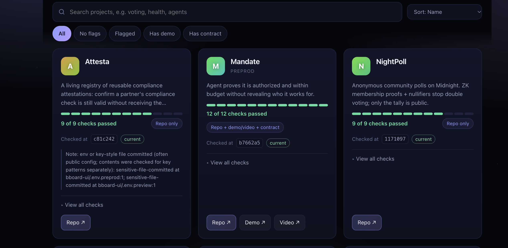
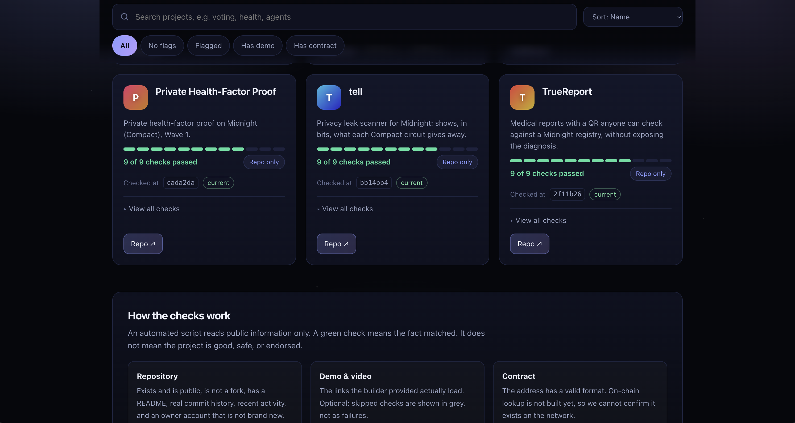
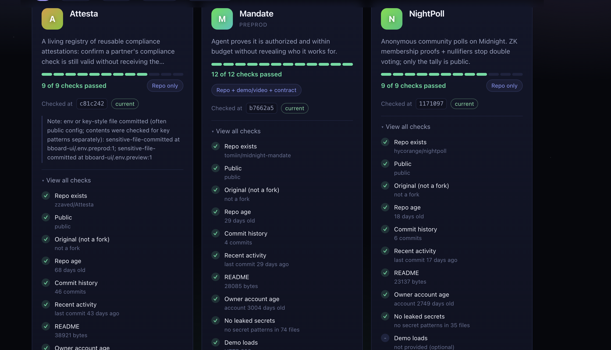
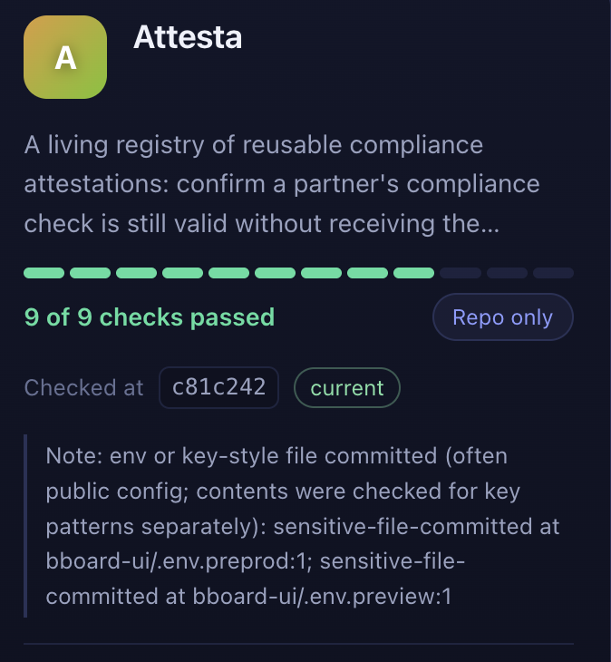
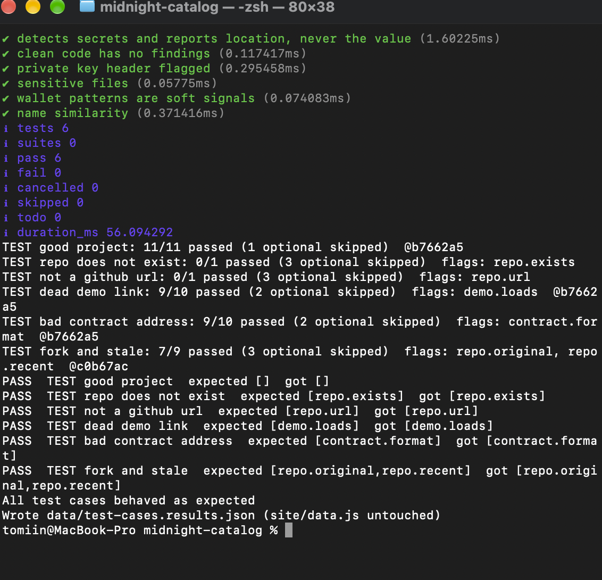

# Midnight Builder Catalog (working name)

Idea from Eva Rodriguez M (Midnight Discord, 2026-10-26): a parallel "ecosystem builder
catalog" to show what people build on Midnight, safe to browse, with an agent that
curates out bad projects automatically.

**Live site:** https://tomiin.github.io/midnight-catalog/

## Screenshots

## Principle
Show EVIDENCE, not verdicts. Every project gets visible checks (repo, commits,
contract, demo). A human reviewer decides edge cases. Builders can appeal.

## Pieces
1. data/projects.json   - the catalog (submitted entries)
2. verifier/verify.mjs  - automated evidence checks (Node 22, no dependencies)
3. site/                - static browse page (next step)
4. Later: AI README read for suspicious claims; ZK-backed claims; on-chain registry.

## Checks (v1)
Every result is bound to the exact commit it was read at (`Checked at abc1234`). If the repo
moves on, the card shows **outdated** instead of silently keeping an old result.

Scored checks (a failure becomes a flag):
- repo: exists, public, not a fork, commit count, last commit, repo age, README, owner account age
- demo / video: URL loads
- contract: address format (on-chain lookup = TODO, needs a Blockfrost key; the Midnight-hosted indexer was retired 2026-09-30)
- scan.secrets: key patterns (AWS, GitHub, Slack, Stripe, Blockfrost, private-key headers) and committed `.env` / key files, read at the checked commit. Reports file and line only, never the value.

Notes (shown as context, never scored, because legitimate projects can match them):
- wallet-risk patterns such as `setApprovalForAll`, unlimited `approve`, `eth_sign`, `drain*()` functions
- name similarity to official Midnight names or to other listings (one character apart)

## Freshness
    node verifier/verify.mjs --freshness   # fetches only each repo's HEAD, reports current or OUTDATED
The site also checks this live in the browser against the GitHub API.

## Tests
    node --test verifier/scan.test.mjs            # offline unit tests for the scanners
    node verifier/verify.mjs data/test-cases.json # live: designed bad cases must be flagged

## Out of scope / honest limits
- No automated agent catches every scam; a human reviews flags.
- False "bad" labels hurt real builders: always show the evidence and allow appeals.
- Check whether Midnight already has an official ecosystem page before building a duplicate.

## Run
  node verifier/verify.mjs data/projects.json
Optional: GITHUB_TOKEN=... for higher API rate limits.

## Next
- [x] Commit-bound results + outdated detection
- [x] Secret scan, soft wallet-risk and name-similarity notes
- [ ] Evidence-receipt format (signed JSON of what was checked, at which commit)
- [ ] Signed, anchored listings; ZK track records (later)
- [ ] Reply to Eva offering a prototype
- [ ] Run verifier on 5-10 real projects (e.g. Wave 1/2 repos) to calibrate
- [ ] Static site reading data/results.json
- [ ] Decide submission flow (GitHub PR to projects.json is simplest and public)
